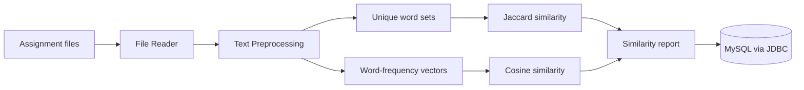
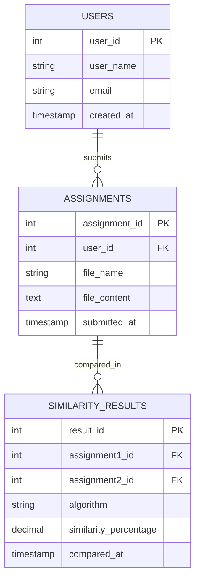

<div align="center">

# 🔍 AI-Based Assignment Similarity and Copy Detection Platform

**Compare student assignments, measure textual overlap, and keep the final decision with the instructor.**


*SRM University-AP · Department of Computer Science and Engineering (CSE-E)*
*Guided by **Dr. Tirthankar Sengupta***

</div>

---

## 📑 Table of Contents
- [Project Overview](#-project-overview)
- [Features](#-features)
- [Technologies Used](#-technologies-used)
- [How It Works](#-how-it-works)
- [Project Structure](#-project-structure)
- [Requirements](#-requirements)
- [Installation and Execution](#-installation-and-execution)
- [Sample Output](#-sample-output)
- [Data Storage](#-data-storage)
- [Object-Oriented Programming Concepts](#-object-oriented-programming-concepts)
- [Limitations and Future Work](#-limitations-and-future-work)
- [Project Team](#-project-team)
- [GitHub Repository](#-github-repository)

---

## 📌 Project Overview
Checking many student assignments one by one takes a lot of time. This project is a **Java console application** that reads two assignment text files, cleans the text, and calculates how similar they are using **Jaccard similarity** and **Cosine similarity**. Users, assignments and results can be stored in a **MySQL** database through **JDBC**.

> ⚠️ **Note:** The scores show textual overlap only. They are decision-support information, not proof of plagiarism. The instructor makes the final decision.

---

## ✨ Features
| Feature | Description |
| --- | --- |
| 📄 File comparison | Compares two assignment text files (UTF-8) |
| 🧹 Text preprocessing | Lowercase conversion, symbol removal, tokenization |
| 📊 Jaccard similarity | Measures shared unique words |
| 📈 Cosine similarity | Compares word-frequency vectors |
| 💾 Database storage | Saves users, assignments and results in MySQL via JDBC |
| 🗂️ Stored records | Menu to view saved assignments and comparison results |
| 🛡️ Error handling | Handles missing, unreadable and empty files |
| ✅ Self-test | `DatabaseTest` checks the JDBC layer and prints PASS / FAIL |

---

## 🛠️ Technologies Used
| Area | Technology |
| --- | --- |
| Language | Java |
| Database | MySQL |
| Connectivity | JDBC (mysql-connector-j) |
| Algorithms | Jaccard similarity, Cosine similarity |
| Concepts | OOP, text preprocessing, feature extraction |

---

## ⚙️ How It Works


1. The user enters the paths of two assignment files.
2. The file is checked and read as UTF-8 text.
3. The text is converted to lowercase, symbols are removed, and words are split into tokens.
4. Jaccard uses the set of unique words; Cosine uses the word-frequency vector.
5. Both percentages are displayed with a note that they are not proof of plagiarism.
6. In database mode, users, files and results are saved through JDBC.

---

## 📁 Project Structure
```
Assignment-Similarity-and-Copy-Detection-Platform
├── src
│   ├── Main.java                 Console entry point
│   ├── FileReaderService.java    Checks and reads files
│   ├── TextPreprocessor.java     Cleans text and creates tokens
│   ├── JaccardSimilarity.java    Jaccard similarity
│   ├── CosineSimilarity.java     Cosine similarity
│   ├── SimilarityService.java    Coordinates the comparison
│   ├── DatabaseManager.java      JDBC connection and database operations
│   ├── DatabaseTest.java         Database self-test
│   └── DatabaseMenu.java         Console menu for the database
├── samples                       Sample assignment files
├── schema.sql                    MySQL table definitions
├── db.properties.example         Database settings template
├── LICENSE
└── README.md
```

---

## 📋 Requirements
- Java JDK 8 or higher
- MySQL Server (only for the database features)
- MySQL Connector/J JAR placed in a `lib` folder

---

## 🚀 Installation and Execution

**1. Get the project**
```
git clone https://github.com/sathvikgudivada-ind/Assignment-Similarity-and-Copy-Detection-Platform
cd Assignment-Similarity-and-Copy-Detection-Platform
```

**2. Set up the database (optional)**
- Start MySQL and put the connector JAR in a `lib` folder.
- Copy `db.properties.example` to `db.properties` and enter your MySQL user name and password.
- 🔒 Never upload `db.properties` to GitHub.

**3. Compile and run (Windows)**
```
javac -d out src/*.java
java -cp "out;lib/*" Main
java -cp "out;lib/*" DatabaseTest
```
On Linux or macOS, use `:` instead of `;` in the classpath.

---

## 🖥️ Sample Output
```
Jaccard similarity    : 85.71%
Cosine similarity     : 94.05%
```
| Score range | Meaning |
| --- | --- |
| 0 – 20% | Low textual similarity |
| 21 – 40% | Limited textual similarity |
| 41 – 60% | Moderate textual similarity |
| 61 – 80% | High textual similarity |
| 81 – 100% | Very high textual similarity |

These ranges only explain the scores. They are not fixed rules for deciding copying.

---

## 🗄️ Data Storage
Database name: `assignment_similarity`


Each comparison creates two result rows: one for Jaccard and one for Cosine. All queries use prepared statements, which avoids SQL injection.

---

## 🧩 Object-Oriented Programming Concepts
| Concept | Use in this project |
| --- | --- |
| Encapsulation | Each class keeps its data and methods together |
| Abstraction | A comparison can be started without knowing the internal calculation |
| Modularity | Separate classes for reading, preprocessing, similarity and database access |
| Exception handling | try-catch and try-with-resources handle file and database errors |

---

## 🔭 Limitations and Future Work
**Limitations**
- Compares words, not meaning, so heavy paraphrasing may not be detected
- Plain-text input and console interface only
- English text only

**Future work**
- TF-IDF weighting and stop-word removal
- Sentence embeddings and advanced NLP
- PDF and Word file support
- Web interface and highlighting of matching text

---

## 👥 Project Team
| Name | Roll Number |
| --- | --- |
| Shaik Nadeem | AP25110010598 |
| Pavan Santhosh | AP25110011006 |
| T. Prasad | AP25110010960 |
| G. Sathvik | AP25110010728 |
| B. Vamsidar Reddy | AP25110011024 |
| K. Joshan Kumar | AP25110011077 |

---

## 🔗 GitHub Repository
👉 https://github.com/sathvikgudivada-ind/Assignment-Similarity-and-Copy-Detection-Platform

<div align="center">

⭐ *If you find this project useful, please give it a star.*

</div>
